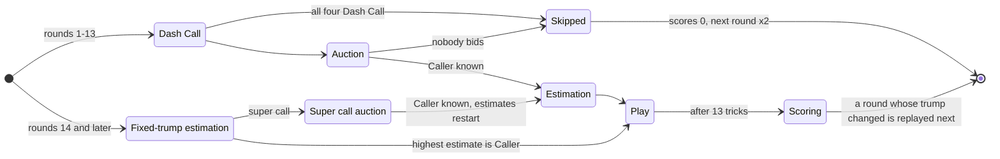
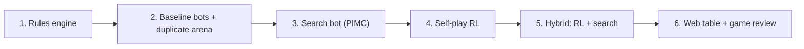

# Estimation Engine: Specification

A bot that plays **Estimation**, the 4-player trick-taking card game, by the rules of the Pocket Estimation app. It is built in six milestones: an exact rules engine, baseline bots with a fair rating arena, a search bot, a self-play RL bot, a hybrid of the two, and a web table with game review.

**Status (2026-10-25):** Milestones 1-3 are done and merged, with an Elo ladder (M2) and an opt-in search bidder (experimental, M3). Measured Elo, RandomBot fixed at 400: HeuristicBot about 3,840, PIMC about 4,830. Next: Milestone 4.

## How to Use This Spec

**For Yosif:** §1 is the whole game in one minute. §4 lists the questions still open.

**For an agent executing a milestone:**
- §2 and §3 are the complete rules. Implement them exactly. Do not add, drop or "fix" a rule. If you need something this spec does not cover, stop and ask.
- §5 is the engine contract every milestone builds on. §6 lists the milestones. Do one at a time. A milestone is done only when every item in its **Done when** list passes; then stop and report. CLAUDE.md has the step-by-step.
- Every rule has an ID such as `EST-5`, and every worked example an ID such as `G2`. Name tests after them.
- MUST means required. SHOULD means do it unless you have a stated reason not to. MAY means optional.

**Where each rule comes from.** Every rule ends with a source tag:

| Tag | Meaning |
| :--- | :--- |
| `[Page]` | The Pocket Estimation rules page, [How to play Estimation](https://blog.pocketestimation.com/en-how-to-play-estimation/), read 2026-10-24 including its images (card order, trump order, bid picker, score table) |
| `[Play]` | Confirmed by Yosif from playing the app. Overrides the page. |
| `[Default]` | Neither the page nor Yosif covers it, so this spec decides. |

**Contents:** 1 Rules at a glance · 2 Game rules · 3 Scoring · 4 Open questions · 5 Engine contract · 6 Milestones · 7 AI design notes · 8 Engineering conventions

---

## 1. Rules at a Glance

- Four players, each for themselves, 13 cards each; play goes counterclockwise. A game is 13 open rounds and then 5 fixed-trump rounds, and the most points wins.
- Right after every deal, each player missing a whole suit is announced as **void**, without saying which suit.
- Rounds 1-13 open with an optional **Dash Call**: a promise to take zero tricks. Starting with the first seat, each player decides in turn, and everyone sees each Dash Call as it is made.
- Then an **auction** for trump. A bid is a number of tricks (4 to 13) plus a trump: Sans (no trump) > Spades > Hearts > Diamonds > Clubs. When everyone else is out, the top bidder gets a final turn to keep or raise. The winner is the **Caller**. Saying **With** at the top bid's number joins it and ends your bidding; if that player raises, you answer: join the new number, stay at yours, or outbid. A player outbid in their own trump who passes is held at their bid. When the auction ends, everyone held in its trump is **With**: scored like the Caller, with that number as their estimate.
- The others **estimate** how many tricks they will take, never more than the Caller. Estimates can never total 13, so someone always fails. A total of 14 or more is an **Over** round, 12 or less an **Under** round. The last estimator takes a **Risk** for every 2 the total is off 13.
- Take exactly your estimate to win: +10 plus your estimate. Miss and you lose the difference. Being Caller or With, each Risk, and being the only winner or only loser each add or subtract 10. In place of the +10 plus estimate, a Dash Call is worth 25 (Over) or 33 (Under), and a **super call** of 8 or more is worth the estimate squared (8 gives +64, or -32 on a miss). A round where 3 or more players are Caller or With counts double.
- Rounds 14-18 have fixed trumps (Sans, Spades, Hearts, Diamonds, Clubs), no Dash Call and no auction: everyone estimates in turn, with no minimum, and the highest estimate becomes Caller. A super call (8 or more in another trump) opens bidding, and if the trump ends up changed, that fixed trump is replayed in the next round.
- If everyone passes in rounds 1-13, the round is skipped and the next one counts double. If everyone fails, the round scores 0 and the next one counts double. These doubles stack: x4, then x8.

---

## 2. Game Rules

### 2.1 Terms

| Term | Meaning |
| :--- | :--- |
| Bola | A full game: 13 open rounds, then the fixed-trump rounds (18 rounds, plus any replays) |
| Open / fixed-trump round | Rounds 1-13 / every round after 13 (FIX-1) |
| `F` | The first seat to act in a round (GAM-2) |
| Opener | The first non-Dash seat counting counterclockwise from F, F included; it opens the auction (GAM-2) |
| Dash caller | A player who made a Dash Call this round |
| Bid | `(tricks, trump)`, made in the auction or as a super call |
| Final turn | The top bidder's last chance to raise, once everyone else is out of the auction (AUC-3) |
| Caller | The winner of the auction, or a super caller. In a fixed-trump round without a super call, the player with the highest estimate. |
| `c` | The Caller's trick count |
| Held call | A bidder's latest call in the auction: the last bid they made, or the bid they said With to (AUC-2) |
| With | A player scored like the Caller (AUC-2, AUC-4, EST-4, FIX-3) |
| `w` | The trick count a With player is held at (AUC-4) |
| Super call | A call of 8 or more tricks by the Caller or a With player, scored by SCR-6. In a fixed-trump round, also the way to open bidding and change the trump (FIX-4). |
| Estimate `B`, tricks `T` | Tricks a player commits to, and tricks they actually take |
| Last estimator | The player who makes the final estimate of the round |
| Over / Under | A round whose estimates total 14 or more / 12 or less |
| Risk | A unit of bonus or penalty for the last estimator (EST-7) |
| Skipped round | An open round with no Caller (GAM-3) |
| Carry | The multiplier a round inherits from the round before it (GAM-4) |

### 2.2 Table and Cards

- **TBL-1** Four seats, numbered 0-3. Each player plays for themselves. `[Page]` (The app's "Couple" team mode is out of scope.)
- **TBL-2** Play goes counterclockwise: the seat after `s` is `(s + 1) % 4`. `[Page]` direction, `[Default]` numbering
- **TBL-3** A standard 52-card deck, dealt at random, 13 cards to each seat. `[Page]`
- **TBL-4** Card rank, high to low: A K Q J 10 9 8 7 6 5 4 3 2. `[Page]`
- **TBL-5** Trumps, strongest first: Sans (no trump), Spades, Hearts, Diamonds, Clubs. `[Page]`
- **TBL-6** One bid beats another if it has more tricks, or the same number of tricks and a stronger trump. `[Page]`
- **TBL-7** **Void announcement.** Right after every deal, before the round's first decision, every player whose 13 cards miss at least one suit is announced to everyone as void. It is automatic, and it says neither which suit nor how many. A player not announced holds all four suits. `[Play]` (confirmed by Yosif 2026-10-26)

### 2.3 Game Structure

- **GAM-1** A game (Bola) is 13 open rounds followed by the fixed-trump rounds, one for each fixed trump (FIX-1). Without super calls in the fixed-trump rounds, that is 18 rounds. `[Page]` 18 rounds, `[Play]` replays (FIX-5)
- **GAM-2** In round `r`, counting every round played (replays included), the first seat to act is `F = (r - 1) % 4`. In an open round, F is asked first for the Dash Call, and the **opener**, the first non-Dash seat counting counterclockwise from F (F included), opens the auction. In a fixed-trump round, F estimates first. `[Default]`
- **GAM-3** An open round with no Caller is **skipped**: nobody bid in the auction (AUC-3), or all four players Dash Called (DSH-5). Everyone scores 0 for it. It still counts as one of the 13 open rounds and is never replayed. Fixed-trump rounds are never skipped. `[Page]` skipping, `[Play]` counting, `[Default]` the all-Dash case
- **GAM-4** The round after a skipped round is played at **x2**: every score in it is doubled. So is the round after an all-lose round (SCR-9). The carry stacks: if that doubled round is also skipped or all-lose, the next one is x4, then x8, and so on. Any other round resets the carry to x1. With `carry_stacks=False`, the carry is always x2. `[Page]` x2, `[Play]` stacking
- **GAM-5** A player's game score is the sum of their round scores. After the last round, the highest game score wins; tied players share the win. `[Page]` winner, `[Default]` ties

### 2.4 Round Flow



### 2.5 Dash Call (Open Rounds)

- **DSH-1** At the start of every open round, each player decides whether to Dash Call: a commitment to take zero tricks. Fixed-trump rounds have no Dash Call (FIX-2). `[Page]`, `[Play]` none in fixed-trump rounds
- **DSH-2** Starting with F and going counterclockwise, each player decides in turn. Every Dash Call is public as soon as it is made, so later players see the earlier choices. `[Play]`
- **DSH-3** Any number of players may Dash Call in the same round. `[Play]`
- **DSH-4** A Dash caller sits out the auction, is never Caller or With, and has a fixed estimate of 0 that counts toward the total. `[Play]`
- **DSH-5** If all four players Dash Call, the round is skipped (GAM-3). `[Default]`

### 2.6 Auction (Open Rounds)

- **AUC-1** The bidders are the non-Dash players. The opener (GAM-2) acts first; turns then go counterclockwise, lap after lap, among bidders who are still in, skipping whoever holds the top bid. A bidder is out once they pass or say With. `[Default]` order, `[Play]` With takes you out
- **AUC-2** On their turn, a bidder does exactly one of:
  - **Bid** a `(tricks, trump)` that beats the current top bid (TBL-6). The lowest bid is 4 Clubs, the highest 13 Sans. `[Page]`
  - **With**, only while another player holds the top bid: join that bid at its trick count `w` and its trump. With is only possible at the top bid's number, and it ends your bidding: from then on you act only to answer that player's raise (AUC-3). `[Play]`
  - **Pass**: out for the rest of the auction. `[Page]`

  Each bidder **holds** their latest call: the last bid they made, or the bid they said With to. Passing keeps it. `[Play]`
- **AUC-3** Whenever every bidder except the top bidder is out, the top bidder gets a **final turn**: keep the bid (Pass), or raise it to any higher bid, with more tricks or the same tricks in a stronger trump. After a raise, each player With on that top bidder answers at once, one at a time counterclockwise from it: say With at the new bid, stay (Pass) and keep their held call, or outbid it. If nobody outbids, the auction ends: the top bidder is Caller, and their bid's trump is the round's trump. If an answer outbids, that player holds the top bid, the old top bidder is back in, the players who have not answered yet no longer answer (AUC-4), and the auction carries on by AUC-1, with a new final turn once every other bidder is out again. If nobody bid at all, the round is skipped (GAM-3). `[Page]` final turn, `[Play]` answers, `[Play]` answer order and an outbidding answer (confirmed by Yosif 2026-10-27)
- **AUC-4** **With follows the trump.** When the auction ends, every other non-Dash player whose held call is in the round's trump is With, held at that call's trick count `w`: for example a player outbid in their own trump who then passed, or a With player who stayed when their bidder raised in the same trump, however high it went. A player whose held call is in another trump is not With. A With player whose bidder is outbid by someone else does not answer later raises: they stay out, keeping their held call. Several players may be With. `[Play]`, including an outbid in the same trump and a With player outbid in another trump whose trump still wins (confirmed by Yosif 2026-10-27)
- **AUC-5** If a bidder is the only non-Dash player, they may not bid 13 tricks, on either turn: nobody would estimate after them, so the total would be 13. `[Default]`
- **AUC-6** **Nobody left to estimate.** If the move that ends the auction would leave every player other than the Caller With or a Dash caller, with the Caller's `c`, the With players' `w` and the Dash callers' 0 totalling 13, that move is not allowed: the top bidder must raise rather than keep, and a With player answering a raise must answer differently. `[Play]`

(Changed 2026-10-26, Yosif: With ends your bidding and you answer your bidder's raises; a player outbid in their own trump is held at their bid; With players' estimates are fixed at their `w`; AUC-6 added.)

The auction always ends: bids only go up, a player who is out comes back only to answer a raise or after outbidding on an answer, and each raise is answered once.

Examples:
- **L1** (answering a raise; held when outbid in your own trump) F = seat 0. Seat 0 bids 4 Hearts, seat 1 bids 5 Hearts, seat 2 says With (`w = 5`), and seat 3 passes. Seat 0 passes, holding 4 Hearts. Everyone but seat 1 is out, so seat 1 has its final turn and raises to 6 Hearts, and seat 2 answers With at 6. Seat 1 is Caller at 6 Hearts, seat 2 is With at 6, seat 0 is With at 4, and seat 3, the only player left to estimate, may estimate 0-6. Caller and two With make 3, so the round counts double (SCR-8). Had seat 2 answered Pass, it would be With at 5. `[Play]`
- **L2** (minimum raise) With a top bid of 5 Hearts held by another player, the legal actions are 5 Spades, 5 Sans, every bid of 6-13 tricks, With and Pass: 44 actions. On the top bidder's own final turn they are the same bids and Pass: 43 actions.
- **L3** (lone bidder) Seats 0, 1 and 2 Dash Call. Seat 3's legal actions are every bid of 4-12 tricks and Pass: 46 actions, no 13-trick bids and no With. If it bids, it then gets its final turn.
- **L10** (With lost to another trump) F = seat 0. Seat 0 bids 4 Hearts, seat 1 says With, seat 2 bids 5 Spades, seat 3 passes and seat 0 passes. Seat 2 keeps 5 Spades on its final turn. Seats 0 and 1 hold Hearts calls, so neither is With: seats 3, 0 and 1 estimate 0-5, in that order. Seat 1 never answered seat 2's bid, because seat 2 is not the player it joined.
- **L11** (outbid in another trump, own trump wins) F = seat 0. Seat 0 bids 4 Hearts, seat 1 bids 5 Spades, seat 2 bids 6 Hearts, and seats 3, 0 and 1 pass. Seat 2 keeps 6 Hearts on its final turn. Seat 0 holds 4 Hearts, so it is With at 4 even though it was outbid in Spades. Seat 1 holds 5 Spades and is not With: seats 3 and 1 estimate 0-6, in that order. `[Play]`

### 2.7 Estimation

EST-1 to EST-4 apply when the Caller is known before estimation: open rounds, and fixed-trump rounds after a super call (FIX-4). EST-5 to EST-7 apply to every round.

- **EST-1** The Caller's estimate is their winning trick count `c`. `[Page]`
- **EST-2** Each With player from the auction has the trick count `w` they are held at (AUC-4) as their estimate, and does not estimate again. The other non-Dash players estimate one at a time, counterclockwise, starting from the seat after the Caller. `[Play]`
- **EST-3** Every estimating player may estimate 0 to `c`. `[Page]` cap of `c`
- **EST-4** A player who estimates exactly `c` is With. `[Page]`
- **EST-5** **Sum rule:** the last estimator may not choose a value that makes the four estimates total 13 (Dash callers count as 0, With players as their `w`). When nobody estimates, AUC-6 has already kept the total off 13. `[Page]` rule, `[Play]` AUC-6
- **EST-6** A total of 14 or more makes the round **Over**; 12 or less makes it **Under**. `[Page]`
- **EST-7** **Risk:** the last estimator takes `abs(total - 13) // 2` Risks. Totals 12-14 give 0, 10-11 and 15-16 give 1, 8-9 and 17-18 give 2, and so on. One exception: when every player other than the Caller is With or Dash Called, nobody estimates, so nobody takes Risk. `[Page]` rule, `[Default]` exception

Examples:
- **L4** (sum rule) Caller seat 0 at 5. Seat 1 estimates 3, seat 2 estimates 4. Seat 3, the last estimator, may estimate 0, 2, 3, 4 or 5 (1 would make 13).
- **L5** (nobody left to estimate, AUC-6) F = seat 0. Seat 3 Dash Calls. Seat 0 bids 4 Hearts, seat 1 says With (`w = 4`), seat 2 bids 5 Hearts, and seat 0 passes, holding 4 Hearts. On its final turn seat 2 may not keep 5 Hearts: seats 0 and 1 would both be With at 4, and 5 + 4 + 4 + 0 = 13 with nobody left to estimate. It may raise, for example to 6 Hearts (total 14), or to 5 Spades, after which seats 0 and 1 hold Hearts calls, are not With, and estimate 0-5.

### 2.8 Fixed-Trump Rounds (14 Onward)

- **FIX-1** After round 13, each round plays the next fixed trump still to be played, in this order: Sans, Spades, Hearts, Diamonds, Clubs. Without super calls these are rounds 14-18. `[Page]` order, `[Play]` replays (FIX-5)
- **FIX-2** There is no Dash Call and no auction. Starting with F and going counterclockwise, each player estimates 0-13 under the fixed trump; nobody has to reach 4. The sum rule (EST-5) and Risk (EST-7) apply to the last estimator. `[Play]` no Dash Call and no minimum, `[Default]` order
- **FIX-3** After all four estimates, the player with the highest estimate is Caller; on a tie, whoever said it first. Every other player with the same estimate is With. `[Page]` highest estimate is Caller, `[Play]` first one wins ties
- **FIX-4** **Super call:** on their turn, instead of estimating, a player may bid 8 or more tricks in a trump other than the fixed one. All estimates are cleared and the bid opens an auction, which runs like AUC-1 to AUC-6 (With, answers and the final turn included), starting with the player after the super caller, who holds the super call. Bids in that auction may be in any trump, the fixed one included. So may the super caller's own later bids, its final turn included; with `super_caller_may_bid_fixed=False` they must stay out of the fixed trump (§4). The winner is Caller, their bid's trump is the round's trump, and estimation restarts as in 2.7. `[Play]` reset and answering, `[Default]` details and the super caller's later bids
- **FIX-5** **Replay:** if a super call leaves the round with a trump other than the fixed one, the round is scored as usual and the next round plays the same fixed trump again. So the game ends only once all five fixed trumps have been played. Safety cap: after `max_fixed_replays` replays in one game (default 20), a changed round is no longer replayed. `[Play]` replay, `[Default]` cap

Examples:
- **L6** (fixed-trump round) Round 15 (Spades), so F = seat 2, and seat 2 decides first with no Dash Call. Its legal actions are every estimate 0-13 and every super call of 8-13 tricks in Sans, Hearts, Diamonds or Clubs: 38 actions.
- **L7** (super call resets) Round 16 (Hearts), so F = seat 3. Seat 3 estimates 2, then seat 0 super-calls 8 Spades. Seat 3's estimate is cleared and an auction opens: seats 1, 2 and 3 pass, and seat 0 keeps 8 Spades on its final turn. Spades is trump, and seats 1, 2 and 3 estimate again in that order, each 0-8. Round 17 then plays Hearts again (G9).
- **L8** (Yosif's classic) Round 15 (Spades), so F = seat 2. Seats 2, 3 and 0 each estimate 3. Seat 1 is last and may not estimate 4: 37 legal actions. If seat 1 also says 3, the total is 12 (Under by 1), seat 2 is Caller because it said 3 first, and the other three are With. If seat 1 says 2 instead, the total is 11 (Under by 2), seat 1 takes 1 Risk, and seats 3 and 0 are With. Both rounds count double (G10). `[Play]`
- **L9** (answering a super call) Same start as L7, but after seat 0's 8 Spades, seat 1 answers 9 Hearts, seats 2, 3 and 0 pass, and seat 1 keeps its bid on its final turn. Seat 1 is Caller at 9 Hearts. The trump is still the fixed one, so round 17 moves on to Diamonds.

### 2.9 Trick Play

- **PLY-1** The Caller leads the first trick; play goes counterclockwise. `[Page]`
- **PLY-2** A player holding a card of the led suit must play one. Otherwise they may play any card. `[Page]`
- **PLY-3** If any trump was played, the highest trump wins the trick. Otherwise the highest card of the led suit wins. An off-suit card that is not trump never wins. Sans rounds have no trump. `[Page]` led suit, `[Default]` trump (standard trick-taking)
- **PLY-4** The trick winner leads the next trick with any card, trump included. `[Page]`
- **PLY-5** After 13 tricks, the round is scored (§3). `[Page]`

Examples:
- **T1** (must follow; the page's own example) The Jack of Hearts is led. A hand of 5♦ 8♦ 2♣ 10♠ A♠ 6♥ K♥ may play only 6♥ or K♥. A hand of 5♦ 8♦ 2♣ 10♠ A♠ may play any of its cards.
- **T2** (trump wins) Trump Spades. Seat 0 leads J♥, seat 1 plays K♥, seat 2 (no Hearts) plays 2♠, seat 3 plays A♥. Seat 2 wins.
- **T3** (off-suit has no value) Trump Spades. Seat 0 leads J♥, seat 1 plays K♥, seat 2 (no Hearts) plays A♦, seat 3 plays 3♥. Seat 1 wins.
- **T4** (Sans) Trump Sans. Seat 0 leads 10♣, seat 1 (no Clubs) plays A♠, seat 2 plays J♣, seat 3 plays 2♣. Seat 2 wins.

---

## 3. Scoring

### 3.1 Round Score per Player

A player **wins** the round if their tricks `T` exactly equal their estimate `B`; otherwise they **lose**. Their round score is the sum of every row that applies, times the multipliers in 3.2.

| ID | Component | Applies to | Win | Loss | Source |
| :--- | :--- | :--- | :--- | :--- | :--- |
| SCR-1 | Base | Every player not scored by SCR-2 or SCR-6 | `+(10 + B)` | `-\|B - T\|` | `[Page]` win, `[Play]` loss |
| SCR-2 | Dash Call | Dash callers, instead of SCR-1 | Over `+25`, Under `+33` | Over `-25`, Under `-33` | `[Page]` values, `[Play]` instead of SCR-1 |
| SCR-3 | Caller / With | The Caller and each With player | `+10` | `-10` | `[Page]` |
| SCR-4 | Risk | The last estimator | `+10` per Risk | `-10` per Risk | `[Page]` |
| SCR-5 | Only winner / only loser | The one winner when exactly one player won; the one loser when exactly one player lost | `+10` | `-10` | `[Page]`, `[Play]` |
| SCR-6 | Super call | The Caller and each With player with `B >= 8`, instead of SCR-1 | `+B*B` | `-(B*B // 2)` | `[Play]` |

- SCR-1 loss `[Play]`: the page's score table shows -10 on every loss, but the app does not apply it. A plain loss costs only the difference.
- SCR-5 also applies to Dash callers and super callers. Each of those two cases has its own switch, both on by default (`only_bonus_for_dash_calls`, `only_bonus_for_super_calls`). `[Play]`
- SCR-6 values: 8 gives +64 / -32, 9 gives +81 / -40, 10 gives +100 / -50.
- Switches (§5.3): with `dash_replaces_base=False`, a Dash caller also gets SCR-1 with `B = 0`. With `super_call_scoring=False`, a super caller gets SCR-1 instead of SCR-6.

### 3.2 Multipliers

- **SCR-7** **Carry:** x2 for the round after a skipped or all-lose round, stacking (GAM-4). `[Page]`, `[Play]` stacking
- **SCR-8** **Three-call double:** if the Caller and With players together number 3 or more, the round's scores are doubled. With `calls_count_risk_and_dash=True`, each Dash caller and 1 for any Risk count toward the 3 as well. `[Play]`
- **SCR-9** **All lose:** if all four players lose, the round's multiplier is 0, so everyone scores 0, and the next round gets a carry (GAM-4). `[Play]`
- **SCR-10** Multipliers multiply: a round with a x2 carry and a three-call double scores x4. `[Default]`

### 3.3 Golden Rounds

These are acceptance tests. G1-G7, G9 and G10 test `score_round` directly; G8 tests `next_carry` and `score_round` with a carry of 2 (§5.4). They use the default config (§5.3) unless a line says otherwise. Every table's tricks add up to 13.

**G1. Plain Over round.** Caller seat 0 at 5 Spades. Estimates in order: seat 1, 2, 3.

| Seat | Role | B | T | Result | Points | Score |
| :--- | :--- | ---: | ---: | :--- | :--- | ---: |
| 0 | Caller | 5 | 5 | win | 10+5, +10 Caller | 25 |
| 1 | | 3 | 3 | win | 10+3 | 13 |
| 2 | | 4 | 3 | loss, only loser | -1, -10 only loser | -11 |
| 3 | Last estimator | 2 | 2 | win | 10+2 | 12 |

Total 14: Over, 0 Risks. Seat 3 could not estimate 1 (L4).

**G2. Under round with With and Risk.** Caller seat 1 at 4 Hearts. Seat 2 said With in the auction (`w = 4`), so its estimate is 4. Estimates in order: seat 3, 0.

| Seat | Role | B | T | Result | Points | Score |
| :--- | :--- | ---: | ---: | :--- | :--- | ---: |
| 1 | Caller | 4 | 4 | win | 10+4, +10 Caller | 24 |
| 2 | With | 4 | 4 | win | 10+4, +10 With | 24 |
| 3 | | 1 | 2 | loss | -1 | -1 |
| 0 | Last estimator, 2 Risks | 0 | 3 | loss | -3, -20 Risk | -23 |

Total 9: Under. Seat 0 could not estimate 4, chose 0, and took `abs(9 - 13) // 2 = 2` Risks. Caller + With is only 2, so no double. With `calls_count_risk_and_dash=True` (Caller + With + Risk = 3): 48, 48, -2, -46.

**G3. Dash Call wins in an Over round.** F = seat 0. Seat 2 Dash Calls. Auction: seat 0 bids 5 Diamonds, seat 1 passes, seat 3 bids 6 Clubs, seat 0 passes, and seat 3 keeps its bid on its final turn. Caller seat 3 at 6 Clubs. Estimates in order: seat 0, 1.

| Seat | Role | B | T | Result | Points | Score |
| :--- | :--- | ---: | ---: | :--- | :--- | ---: |
| 3 | Caller | 6 | 6 | win | 10+6, +10 Caller | 26 |
| 0 | | 4 | 4 | win | 10+4 | 14 |
| 1 | Last estimator | 4 | 3 | loss, only loser | -1, -10 only loser | -11 |
| 2 | Dash caller | 0 | 0 | win | +25 Dash (Over) | 25 |

Total 14: Over, 0 Risks (seat 1 could not estimate 3). With `dash_replaces_base=False`: seat 2 scores 10 + 0 + 25 = 35.

**G4. Dash Call fails in an Under round.** Seat 0 Dash Calls. Caller seat 1 at 5 Spades. Estimates in order: seat 2, 3.

| Seat | Role | B | T | Result | Points | Score |
| :--- | :--- | ---: | ---: | :--- | :--- | ---: |
| 1 | Caller | 5 | 5 | win | 10+5, +10 Caller | 25 |
| 2 | | 3 | 3 | win | 10+3 | 13 |
| 3 | Last estimator | 4 | 4 | win | 10+4 | 14 |
| 0 | Dash caller | 0 | 1 | loss, only loser | -33 Dash (Under), -10 only loser | -43 |

Total 12: Under, 0 Risks (seat 3 could not estimate 5). With `dash_replaces_base=False`: seat 0 scores -1 - 33 - 10 = -44. With `only_bonus_for_dash_calls=False`: seat 0 scores -33.

**G5. Super call at 8.** Caller seat 0 at 8 Spades. Estimates: seat 1 estimates 2, seat 2 estimates 1, seat 3 (last) estimates 3. Total 14: Over, 0 Risks.

| Case | Tricks (seats 0, 1, 2, 3) | Scores (seats 0, 1, 2, 3) | Seat 0's points |
| :--- | :--- | :--- | :--- |
| (a) Caller makes it | 8, 2, 1, 2 | 74, 12, 11, -11 (seat 3 only loser) | +64 super call, +10 Caller |
| (b) Caller fails | 7, 2, 1, 3 | -52, 12, 11, 13 (seat 0 only loser) | -32 super call, -10 Caller, -10 only loser |

With `super_call_scoring=False`, seat 0 scores 28 in (a) and -21 in (b). With `only_bonus_for_super_calls=False`, seat 0 scores -42 in (b).

**G6. Everyone loses.** F = seat 0. Auction: seat 0 bids 4 Clubs, seat 1 says With, seats 2 and 3 pass, and seat 0 keeps its bid on its final turn. Seat 1 is With at 4, so its estimate is 4. Estimates: seat 2 estimates 4 (so it is With too), seat 3 (last) estimates 0 (1 would make 13). Total 12: Under, 0 Risks. Tricks: 5, 3, 2, 3, so every player lost.

| Config | Scores (seats 0, 1, 2, 3) | Next round |
| :--- | :--- | :--- |
| Default | 0, 0, 0, 0 | x2 |
| `all_lose_doubles_next=False` | -22, -22, -24, -6 (x2: Caller + 2 With = 3) | x1 |

**G7. Fixed-trump round, tie for Caller.** Round 14 (Sans), so F = seat 1. No super call. Estimates in order: seat 1 estimates 3, seat 2 estimates 5, seat 3 estimates 5, seat 0 (last) estimates 1 (0 would make 13). Total 14: Over, 0 Risks. Seats 2 and 3 tie on 5. Seat 2 said it first, so seat 2 is Caller and leads the first trick, and seat 3 is With.

| Seat | Role | B | T | Result | Points | Score |
| :--- | :--- | ---: | ---: | :--- | :--- | ---: |
| 1 | | 3 | 3 | win | 10+3 | 13 |
| 2 | Caller | 5 | 5 | win | 10+5, +10 Caller | 25 |
| 3 | With | 5 | 4 | loss, only loser | -1, -10 With, -10 only loser | -21 |
| 0 | Last estimator | 1 | 1 | win | 10+1 | 11 |

**G8. Skipped round and carry.** Round 3: everyone passes, so round 3 is skipped and everyone scores 0. It still counts as one of the 13 open rounds. Round 4 is x2: if it plays out like G1, the seats score 50, 26, -22, 24. Round 5 is back to x1. If rounds 6 and 7 are both skipped, round 8 is x4; with `carry_stacks=False` it is x2.

**G9. Super call in a fixed-trump round.** The L7 round. After the reset, seat 1 estimates 2, seat 2 estimates 1, and seat 3 (last) estimates 3 (2 would make 13). Total 14: Over, 0 Risks. Spades is trump and seat 0 leads.

| Seat | Role | B | T | Result | Points | Score |
| :--- | :--- | ---: | ---: | :--- | :--- | ---: |
| 0 | Caller, super call | 8 | 8 | win | +64 super call, +10 Caller | 74 |
| 1 | | 2 | 2 | win | 10+2 | 12 |
| 2 | | 1 | 0 | loss, only loser | -1, -10 only loser | -11 |
| 3 | Last estimator | 3 | 3 | win | 10+3 | 13 |

Round 17 replays Hearts, then round 18 plays Diamonds and round 19 Clubs. The game ends after round 19.

**G10. Yosif's classic, 3-3-3-3.** The L8 round: round 15 (Spades), estimates in order seat 2, 3, 0, 1. In (a) all four say 3, so seat 2 is Caller and the other three are With: Caller + 3 With = 4, so x2. In (b) seat 1 says 2 instead and takes 1 Risk: Caller + 2 With = 3, still x2.

| Case | Total | Tricks (seats 0, 1, 2, 3) | Scores (seats 0, 1, 2, 3) |
| :--- | :--- | :--- | :--- |
| (a) 3c-3w-3w-3w | 12, Under by 1 | 3, 4, 3, 3 | 46, -42, 46, 46 (seat 1 only loser) |
| (b) 3c-3w-3w-2r | 11, Under by 2 | 3, 3, 3, 4 | 46, -22, 46, -22 |

---

## 4. Open Questions

- [ ] **Super caller and the fixed trump (FIX-4).** After a super call, may the super caller itself bid the fixed trump later in that auction, for example by raising into it on its final turn? That keeps the fixed trump, so the round is not replayed. Not yet checked in the app. Working default: yes (`super_caller_may_bid_fixed=True`), kept by Yosif on 2026-10-25 until he checks the app; the switch turns it off.

- [x] **Order of answers (AUC-3).** When several players are With on the top bidder and it raises, they answer one at a time, counterclockwise from it. Confirmed by Yosif 2026-10-27, as the working default: that order.
- [x] **An answer that outbids (AUC-3).** Two players are With on the top bidder, it raises, and the first to answer outbids instead of joining or staying. Does the second still answer? Confirmed by Yosif 2026-10-27, as the working default: no; the bid it joined is no longer the top bid, so it stays out holding its call, and the auction carries on in turn.
- [x] **A With player's bidder outbid in the same trump (AUC-4).** You say With on Seat 1's 5 Hearts and Seat 2 then bids 6 Hearts. Confirmed for another trump: you are out. Working default for the same trump: also out, held at 5 Hearts (so With at 5 if Hearts wins), and you do not answer Seat 1 if it raises again later.
- [x] **A With player outbid in another trump (AUC-4).** You say With on Seat 1's 5 Hearts, then another player outbids with 6 Spades: your With is gone and you are out (confirmed 2026-10-26). If the auction still ends in Hearts, for example Seat 1 later bids 7 Hearts and wins, are you With at 5? Confirmed by Yosif 2026-10-27, as the working default: yes, as for a bidder outbid in another trump whose own trump wins (L11).

When a new question comes up, add it here as a checkbox with its working default, tag the affected rule `[Default]`, and update §5.3 and the examples once it is answered.

---

## 5. Engine Contract

Everything Milestone 1 builds and every later milestone relies on. Names SHOULD match, so later milestones can find them.

### 5.1 Encodings

- **Seats:** 0-3; the next seat is `(s + 1) % 4`.
- **Suits:** Clubs 0, Diamonds 1, Hearts 2, Spades 3. **Trumps:** the four suits plus Sans 4, so a higher index is a stronger trump.
- **Ranks:** 2 is 0, 3 is 1, ..., 10 is 8, J is 9, Q is 10, K is 11, A is 12.
- **Card id:** `suit * 13 + rank`, 0-51. Text form for tests and logs: rank then suit letter, with T for ten: `2C`, `TS`, `JH`, `AS`.
- **Hands:** 52-bit integer bitmasks (bit `i` is card id `i`) in hot paths.
- **Deal:** `deal(seed, round_no)` returns the four hands. Use `numpy.random.default_rng([seed, round_no]).permutation(52)`; seat `i` gets positions `13*i` to `13*i + 12`. A round's deal depends only on the seed and round number, never on play. That is what makes duplicate matches (M2) possible.

### 5.2 Action Space

One fixed list of 120 action ids covers every decision. RL depends on it, so it MUST NOT change.

| Ids | Action |
| :--- | :--- |
| 0 | No Dash Call |
| 1 | Dash Call |
| 2-51 | Bid `(n, trump)`, id `2 + (n - 4) * 5 + trump`, for n from 4 to 13. A higher id is always a stronger bid. Super calls (FIX-4) use these ids too. |
| 52 | With. On an answer to a raise (AUC-3), With at the new bid. |
| 53 | Pass. On the top bidder's final turn (AUC-3), it means "keep my bid"; on a With player's answer to a raise, "stay at my number". |
| 54-67 | Estimate `k`, id `54 + k`, for k from 0 to 13 |
| 68-119 | Play a card, id `68 + card id` |

### 5.3 Rules Config

A frozen dataclass. Its defaults MUST match §2 and §3, and every flag MUST be tested both on and off.

```python
@dataclass(frozen=True)
class RulesConfig:
    win_base: int = 10  # SCR-1: a win scores win_base + B
    caller_with_bonus: int = 10  # SCR-3
    risk_points: int = 10  # SCR-4, per Risk
    only_bonus: int = 10  # SCR-5
    only_bonus_for_dash_calls: bool = True  # SCR-5
    only_bonus_for_super_calls: bool = True  # SCR-5
    dash_over: int = 25  # SCR-2
    dash_under: int = 33  # SCR-2
    dash_replaces_base: bool = True  # SCR-2
    super_call_scoring: bool = True  # SCR-6
    super_call_min: int = 8  # SCR-6 and FIX-4
    super_caller_may_bid_fixed: bool = True  # FIX-4, open question (§4)
    calls_to_double: int = 3  # SCR-8
    calls_count_risk_and_dash: bool = False  # SCR-8
    all_lose_doubles_next: bool = True  # SCR-9
    carry_stacks: bool = True  # GAM-4
    max_fixed_replays: int = 20  # FIX-5 safety cap
```

### 5.4 API

Python package `estimation`, engine code in `estimation.engine`.

- `deal(seed, round_no) -> tuple[int, int, int, int]`: the four hands as bitmasks (5.1).
- Pure rule functions, each tested directly:
  - `score_round(outcome: RoundOutcome, config) -> RoundResult` implements §3. `RoundOutcome` holds each seat's estimate and tricks, the Dash callers, the Caller, the With players, the last estimator, the Risk count and the carry. Tested by G1-G10.
  - `next_carry(carry_in, skipped, all_lost, config) -> int` implements GAM-4: after a skipped round, or an all-lose round with SCR-9 on, it returns `carry_in * 2` if `carry_stacks` is on and 2 otherwise; after any other round it returns 1. Tested by G8.
  - `legal_plays(hand, trick) -> list[int]` implements PLY-2, and `trick_winner(trick, trump) -> int` implements PLY-3. `trick` is the cards played so far as `(seat, card)` pairs in play order. Tested by T1-T4.
- `Round`: one round as a state machine.
  - `Round.new(round_no, hands, fixed_trump=None, carry=1, scores=(0, 0, 0, 0), config=RulesConfig())`. `fixed_trump` is `None` in open rounds. `scores` are the game scores so far, shown in observations.
  - `phase`: one of `DASH`, `AUCTION`, `ESTIMATION`, `PLAY`, `DONE`. Open rounds run `DASH`, `AUCTION`, `ESTIMATION`, `PLAY`, `DONE`, and a skipped round goes straight to `DONE`. Fixed-trump rounds run `ESTIMATION`, then `AUCTION` and `ESTIMATION` again if someone super-calls (FIX-4), then `PLAY`, `DONE`.
  - `current_player`: the seat to act, or `None` in `DONE`.
  - `legal_actions() -> list[int]`, and `legal_mask()` returning a NumPy bool array of length 120. Both are empty in `DONE`.
  - `step(action)`: applies a legal action. Raises `IllegalActionError` on an illegal one, including any action in `DONE`; never silently corrects it.
  - `observation(seat) -> Observation`
  - `clone()`, and `Round.replay(round_no, hands, fixed_trump, carry, scores, config, actions)` to rebuild a round from its action log. Two rounds are in the same state when `phase`, `current_player`, `observation(seat)` for all four seats and (once `DONE`) `result()` are all equal.
  - `result() -> RoundResult`, once `phase == DONE`.
- `Bola(seed, config=RulesConfig())`: a full game. It has the same `phase`, `current_player`, `legal_actions`, `step` and `observation`, plus `round_no`, `scores`, `history` (one `RoundResult` per round, skipped and replayed rounds included), `is_over` and `winners()` (every seat tied for the top score, GAM-5). It deals, picks each round's fixed trump, applies the carry, replays fixed-trump rounds whose trump changed (FIX-5) and moves to the next round by itself. Once `is_over`, it behaves like a round in `DONE`.
- `Observation`: everything one seat may see, and nothing else. That is: round number, phase, current player, carry, game scores, the fixed trump (if any), the fixed trumps still to play, replays so far, whether a super call was made, the trump (once known), own remaining hand, the public action log, the players announced void (TBL-7), Dash callers, Caller and bid, With players with their `w` and trump (during the auction: the players out of it who hold a call in the top bid's trump), estimates so far, the last estimator, Over/Under and Risks (once known), the current trick, past tricks (leader, cards, winner) and tricks won per seat. It MUST NOT expose another seat's cards. Dash Calls are public as soon as they are made (DSH-2).
- `RoundResult`: per seat: estimate, tricks, won, role flags (Dash caller, Caller, With, super call, last estimator), Risks, the points from each of SCR-1 to SCR-6, the multiplier and the final score. Per round: skipped, trump changed by a super call (so `Bola` replays it), estimate total, Over/Under, special-call count, all-lose and the carry for the next round. Under SCR-9 an all-lose round has multiplier 0, so components times multiplier always equals the final score.

### 5.5 Performance

At least 5,000 complete random-play rounds per second on one core of the dev Mac. A random-play round is the deal, every decision taken uniformly at random from the legal actions, and scoring. Measure it with `uv run python -m estimation.engine.bench`. If pure Python cannot reach it after profiling, report the number and stop: do not switch language or add native extensions without asking.

---

## 6. Milestones



Do one milestone at a time, on its own branch (CLAUDE.md has the step-by-step). Before reporting a milestone done, run the `spec-checker` subagent and fix what it finds. When the **Done when** list passes, stop and report; do not start the next one unprompted.

### M1. Rules Engine

**Goal:** a fast, exact implementation of §2 and §3, following the contract in §5.

**Build:** the project scaffold from §8 (uv project, ruff, pyright, pytest with hypothesis, pre-commit), everything in §5, and a seeded random-policy helper for tests.

**Done when:**
1. Every rule ID in §2 and §3 has at least one test whose name contains it, for example `test_EST_5_last_estimator_cannot_make_13`.
2. G1-G10, L1-L11 and T1-T4 pass exactly, including every flag variant they list.
3. Every `RulesConfig` flag is tested both on and off.
4. Property tests over 2,000 random Bolas under the default config, plus 200 more with each flag flipped from its default. Random play super-calls often, so expect games to reach the replay cap. Check that:
   - every game ends, with no exceptions
   - every played round uses all 52 cards once across 13 tricks
   - estimates never total 13, and at least one player loses every played round
   - `legal_actions()` is never empty before the game ends
   - every `RoundResult`'s components times its multiplier give its final score, and game scores equal the sum of round scores
   - each fixed trump is eventually played without its trump changing, unless the replay cap was reached
   - no observation reveals another seat's cards
5. `Round.replay` of a recorded action log reproduces the same state (as defined in §5.4), and two `Bola`s with the same seed and actions have identical `scores` and `history`.
6. The benchmark reaches 5,000 rounds per second (§5.5); report the number.
7. ruff, pyright and pytest pass through pre-commit.
8. The `spec-checker` subagent reports no Wrong, Missing or Invented findings.

**Out of scope:** bots other than random play, UI, ML.

### M2. Baseline Bots and Duplicate Arena

**Goal:** measure bot strength with deal luck removed.

**Build:**
- **Bot interface:** `act(obs: Observation, legal: list[int]) -> int`. A bot sees only its own `Observation`.
- **RandomBot:** picks uniformly from the legal actions. It anchors the Elo scale at 400.
- **HeuristicBot:** Dash Calls with a hopeless hand. Bids and estimates from high cards (A, K, Q) and trump length, and super-calls only with a very strong hand. In play, tries to win tricks until it reaches its estimate, then ducks.
- **Duplicate runner:** a lineup is 4 bots, one per seat, repeats allowed. A duplicate set plays one seed's deals 4 times, rotating the lineup so that in rotation `k` seat `i` gets bot `(i + k) % 4`. Every bot plays every hand.
- **Metrics:**
  - Relative Score Advantage (RSA): a bot's Bola score minus the mean of the other three seats, averaged over all its Bolas, with a 95% confidence interval over duplicate sets.
  - First place: the share of its Bolas each seat of a bot finishes first, ties shared (a fair share is 25%), with a 95% confidence interval over duplicate sets. The headline result from M4 on, since finishing first is what wins a game; RSA stays as the more sensitive backup.
  - Elo: a Bradley-Terry fit over pairwise results, with RandomBot fixed at 400 (moved from 800 on 2026-10-25, Yosif). Within each duplicate set, every pair of different bots is compared by score across the set: total score when both fill the same number of slots, mean Bola score per seat otherwise. One virtual draw per pair keeps a clean sweep finite, and the report states the lower bound a sweep supports.
  - Elo ladder: bots too far apart to compare directly (one wins every set) are rated through bots of in-between strength. Each neighbouring pair plays its own duplicate run and one Bradley-Terry fit rates them all: `uv run python -m estimation.arena.ladder --sets 200 --workers 5`. The default ladder runs RandomBot, HeuristicBot with 75% down to 1% random moves (`heuristic:noise=p`), HeuristicBot, PIMC with 1 to 30 deals, and is calibrated so each bot wins about 60-95% of its sets against the one below.
- **CLI:** `uv run python -m estimation.arena --lineup heuristic,random,heuristic,random --sets 1000 --seed 0`.

**Done when:** HeuristicBot vs RandomBot over 1,000 sets has an RSA confidence interval above 0. The same seed gives the same report. Elo is reported (expect about 1200).

**Result (done 2026-10-24):** HeuristicBot's RSA is +1,670 per Bola (95% CI +1,639 to +1,702) and it won all 1,000 sets; the same seed gives the same report on 1 or 2 workers. The ladder (200 sets per pair) rates HeuristicBot at about 3,840. The 1,200 guess assumed a much smaller spread: RandomBot is extraordinarily weak at this game, and comparing whole duplicate sets stretches Elo gaps.

### M3. Search Bot (PIMC)

**Goal:** strong card play from search, with no training. Target: clearly above HeuristicBot on the Elo ladder.

**Build:**
- Track voids (a player who did not follow suit has none of that suit), the void announcements (TBL-7) and played cards.
- At each card decision, sample N = 30 deals of the unseen cards. Samples MUST be consistent with hand sizes, voids, played cards and the void announcements (a player announced void misses a suit in its dealt hand, any other player holds all four), and SHOULD be weighted by how well they fit each player's estimate.
- For each legal card and each sample, play out the rest of the round with HeuristicBot's card play for every seat, and score it with §3. Choose the card with the best mean of (own round score minus the mean of the other three).
- Dash Call, bidding and estimation reuse HeuristicBot.
- Budget: at most 250 ms per card decision at N = 30, configurable.

**Done when:** it beats HeuristicBot in the arena (RSA confidence interval above 0, at least 200 sets), decisions stay within budget, and Elo is reported.

**Result (done 2026-10-24):** with three HeuristicBots over 200 sets, PIMC's RSA is +172 per Bola (95% CI +167 to +177) and it won all 200 sets. Card decisions: mean 4.5 ms, slowest 83 ms, none over 250 ms. The ladder rates PIMC at about 4,830, about 990 above HeuristicBot; even PIMC with a single deal is about 430 above it, and each doubling of deals adds less.

**Experiment: search bidding (opt-in, `pimc:bid_search=true`).** Dash Calls, bids and estimates chosen the same way as cards, by simulating each candidate's round on sampled deals. Its simulated opponents play HeuristicBot's naive card play and never sabotage a Dash caller, so it Dash Calls in about 40% of rounds; against PIMC players those calls fail 72% of the time and it loses every set to plain PIMC. With Dash Calls left to HeuristicBot it only draws level. It stays off by default: search is only as good as its model of the other players, and M4's learned bidding trains on real outcomes instead.

### M4. Self-Play RL

**Goal:** learned bidding and card play that beats the search bot.

**Starting design.** Change it only with evidence, and record the change in this section.
- **State encoder** (about 420 features), built from `Observation`:
  - own hand (52)
  - played cards and trick history (52+)
  - opponent voids (12)
  - round context: fixed-trump round, super call made (a FIX-4 super call reopened bidding, as `Observation.super_call` means), contract of 8 or more (scored as a super call by SCR-6), trump one-hot (5), Over/Under delta, carry and round multiplier
  - per player: estimate, tricks so far, `points_if_win`, `points_if_lose`, still alive or already broken
  - scoreboard: scores, gap to 1st place, open rounds and fixed trumps left
- **BiddingNet:** predicts the expected round score of each legal Dash Call, bid, With, Pass, estimate and super call action.
- **CardPlayNet** (actor-critic / Deep Monte Carlo):
  - Critic: predicts the expected score from the current state, separating deal luck from skill.
  - Actor / Q-head: predicts the advantage of each legal card.
- **Networks:** 4-layer MLPs, about 500K parameters each, in PyTorch (MPS on the dev Mac).
- **Reward:** own score change minus a standings-weighted change in opponents' scores: each opponent ahead of you in the game counts 1.0 and each opponent behind you 0.5. The weights are config values, to be tuned later with arena evidence. Blended with match-win probability in the fixed-trump rounds. (Changed 2026-10-25, Yosif: every opponent above you counts, not only the leader.)
- **Training opponents** (added 2026-10-25): about 70% of games against itself and recent checkpoints, 15% against HeuristicBot and its noisy versions, 15% against a lighter PIMC (4-8 deals), so it does not only learn to beat its own habits.
- **Warm start** (added 2026-10-25): CardPlayNet first imitates PIMC's card choices from recorded PIMC games, then improves by self-play. BiddingNet learns from scratch by self-play, since HeuristicBot's bidding is weak and bidding is where new strategy is most wanted.
- **Stakes as input:** `points_if_win` and `points_if_lose` are computed from `RulesConfig`, so a rule change does not need a retrain from scratch.

**Done when:** it beats HeuristicBot: in a lineup with three HeuristicBots over at least 200 sets, its first-place share's 95% confidence interval is above the fair 25% and its RSA confidence interval is above 0. Its result against PIMC is reported the same way, and it is rated on the Elo ladder. Training is reproducible from a config file and seed, checkpoints are saved with their ladder Elo, and training fits in 18 GB of RAM.

### M5. Hybrid: RL + Search

**Goal:** superhuman play, clearly above the M3 and M4 bots on the Elo ladder, inspired by AlphaZero and NooK (bridge AI).

**Build:** the M3 search, with BiddingNet weighting the sampled deals and CardPlayNet evaluating positions in place of HeuristicBot rollouts.

**Done when:** it beats both the M3 and M4 bots in the arena (RSA confidence interval above 0).

### M6. Web Table and Game Review

**Goal:** play and study games against the engine locally.

**Build:**
- A FastAPI backend wrapping `Bola` and the bots, and a Next.js frontend. Local only, served through portless.
- Play a full Bola against any saved checkpoint or ladder bot, chosen by its Elo (RandomBot at 400 up to the strongest bot).
- **Coach mode** (toggle): the expected score of your hand after the deal, and the change in win probability after every trick.
- **Post-round review:** step through each trick and label each of your card plays by expected points lost against the best move:
  - **Best:** the best move.
  - **Inaccuracy (?):** loses 2 or more points.
  - **Blunder (??):** loses 5 or more points.
  - **Brilliant Sabotage (!!):** the best move, and it cuts the leader's expected score by 5 or more.
  - The thresholds are config values.

**Done when:** a full Bola can be played end to end in the browser, and the review labels for a recorded game match the engine's evaluations.

---

## 7. AI Design Notes

Why the milestones are shaped the way they are.

- **Hidden information.** Estimation is a 4-player, non-zero-sum, imperfect-information game. There are about 5.36 × 10^28 possible deals. From one seat, the 39 unseen cards can be split among the other three players in about 8.45 × 10^16 ways.
- **Exact contracts.** Taking more tricks than you estimated fails just like taking fewer.
- **Forced failure.** Estimates never total 13, so every round is Over or Under and at least one player fails. That creates shifting alliances and sabotage.
- **Sabotage.** Once your own contract is broken or unmakeable, the best play is often breaking someone else's, especially the Caller's or the match leader's.
- **Fixed-trump rounds play differently.** There is no auction, no Dash Call and no minimum, so the Caller usually did not choose the trump, and trumps are spread around the table instead of concentrated in the Caller's hand. Low, crowded rounds such as 3-3-3-3 are common, and with 3 or more Callers and Withs they count double. A super call changes all of that, at the price of replaying the fixed trump.
- **Luck vs skill.**
  - Training learns from advantage: actual score minus the expected score of the hand.
  - Evaluation uses duplicate play, so every bot plays every hand and deal luck cancels out.

---

## 8. Engineering Conventions

- **Stack:** Python 3.12, `uv` for the environment and dependencies, NumPy. PyTorch from M4.
- **Layout:**
  ```
  SPEC.md                  this spec
  CLAUDE.md                instructions every agent session reads
  .claude/agents/          project subagents (spec-checker)
  src/estimation/engine/   M1: cards, actions, config, round, bola, scoring, observation, bench
  src/estimation/bots/     M2-M5: random, heuristic, pimc, rl, hybrid
  src/estimation/arena/    M2: duplicate runner, ratings, CLI
  src/estimation/rl/       M4: encoders, networks, training
  server/                  M6: FastAPI app
  web/                     M6: Next.js app
  tests/                   mirrors src/estimation/
  ```
- **Quality gates:** `ruff` (lint and format), `pyright` (strict for `src/estimation/engine`), and `pytest` with `hypothesis`. All run in pre-commit, and all must pass before a milestone is done.
- **Commands:** `uv run pytest`, `uv run ruff check .`, `uv run ruff format .`, `uv run pyright`, `uv run python -m estimation.engine.bench`, `uv run python -m estimation.arena --lineup ... --sets ... --seed ...`, `uv run python -m estimation.arena.ladder --sets 200 --workers 5`.
- **Git:** the repo starts on `main` with this spec and the agent setup. Each milestone gets its own branch from `main` (for example `m1-rules-engine`) and conventional commits (for example `feat(engine): add auction`). Never commit directly to `main`; Yosif merges.
- **Agent setup:** `CLAUDE.md` tells every agent session how to work with this spec, and `.claude/agents/spec-checker.md` audits the code against it before a milestone is done. Keep both in step with this spec.
- **Reproducibility:** every random choice takes an explicit seed, so the same seed and actions always give the same game.
- **Machine:** the dev Mac (M3 Pro: 5 performance and 6 efficiency cores) has 18 GB of RAM. Run tests with at most 2 workers, and only one heavy job (training, a large arena run) at a time. Arena and ladder runs use 5 workers (about 4x faster, about 50 MB each); 10 workers is about 7x for batch runs, but decision timings then run on slower cores.
